# Graph particle filter — algorithm flowcharts

Reference for `agents/activity_particle_filter.py` (`GraphParticleFilter`), the goal
inference in GAP's Anticipation stage.
Called from `agents/robot_policy_hybrid.py` on human relocations, robot
placements, and human undos.

---

## 1. Lifecycle overview

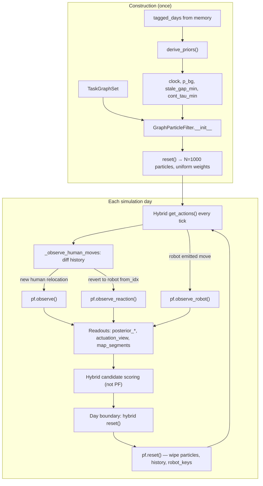

**Important:** New activities **only** open inside `observe()` on a human
relocation. Robot moves and time alone never call `open.append`.

---

## 2. Particle state

Each of **N = 1000** particles carries:

| Field | Meaning |
|-------|---------|
| `open` | ≤ **MAX_OPEN = 3** hypotheses (`_Open` each) |
| `history` | Closed segments `(activity, t_open, t_close)` |
| `last_assign` | Label after last human `observe` roulette (`__background__` or activity name) |

Each **`_Open`** hypothesis:

| Field | Meaning |
|-------|---------|
| `act`, `pos` | Activity name and graph marker node |
| `opened_t`, `last_t` | Segment start; last human advance time |
| `done` | Nodes satisfied (human and/or robot) |
| `robot_done` | Subset satisfied by robot only (undo target) |
| `anchor_t`, `anchor_pos` | Human pace anchor (robot advance does **not** update) |

Filter-level state: `weights[N]`, `_t_last_obs`, `_robot_keys_today`, `_path_cache`.

---

## 3. `derive_priors(tagged_days)` — training-derived scalars

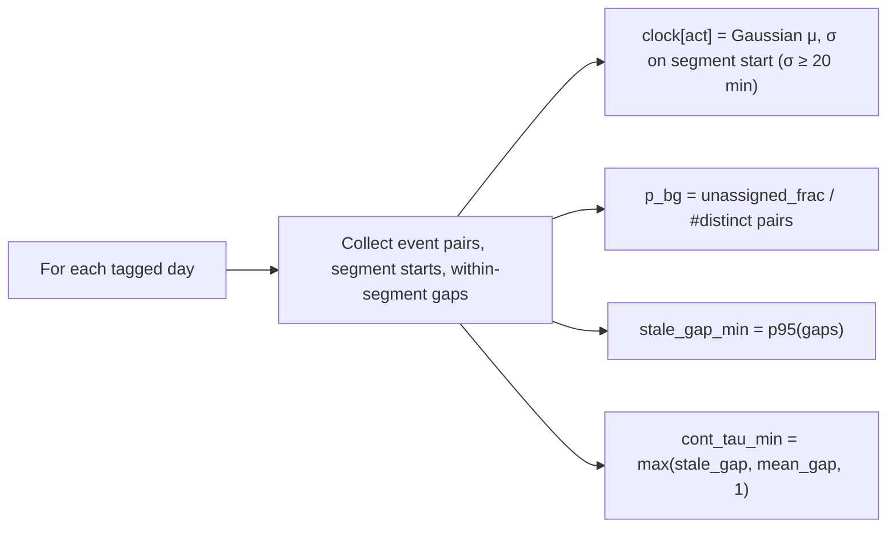

---

## 4. `observe(obj_idx, dest_idx, t)` — human relocation

**Trigger:** hybrid detects a new human move; passes `t = t_min = t_now`.

**Δt:** `t − _t_last_obs` (0 on first human move of the day; robot-only ticks do
not update `_t_last_obs`).

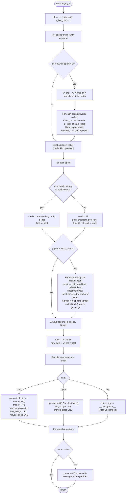

### 4.1 Interpretation credits (likelihood mixture)

| Kind | When added | Credit formula |
|------|------------|----------------|
| **continue (re-obs)** | Exact graph node for key already in `done` | `max(reobs_credit(act,nid), p_bg)` |
| **continue (forward)** | Path from current `pos` explains key | `path_credit(act, pos, key)` if > 0 |
| **open new** | Activity not in `open`, room under cap | `path_credit(act, START or robot anchor, key) × clock(act,t)` if > 0 |
| **background** | Always | `p_bg` |

Particle weight multiplies by **sum of all credits** (marginal likelihood).
One interpretation is **roulette-sampled** for state update.

### 4.2 Activity closing inside `observe`

| Mechanism | When | Close probability | Recorded close time |
|-----------|------|-------------------|---------------------|
| **Idle stale close** | Before scoring, if `dt > 0` | `1 − exp(−dt / stale_gap_min)` per open | `last_t` |
| **Graph END close** | After continue or open-new (`_maybe_close`) | `transition_probs(pos)[END]` | current `t` |

Background assignment does **not** close opens.

---

## 5. `_path_credit(act, src, key)` — shared subroutine

Used by `observe` (continue / open) and `observe_robot` (advance check).

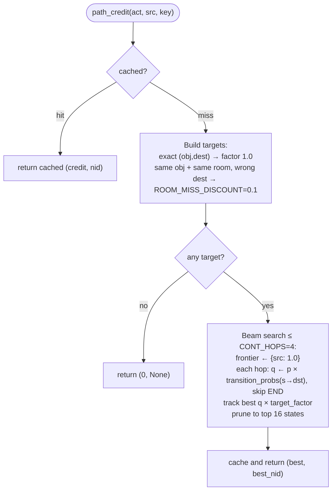

**Transition probs** (from `TaskGraph.transition_probs`):

```
P(dst | src) = (count(src→dst) + 0.5) / (Σ_j count(src→j) + 0.5 × #successors)
```

Successors = observed edges only (including **END**). END is never extended
during path search.

---

## 6. `observe_robot(obj_idx, dest_idx, t)` — robot placement

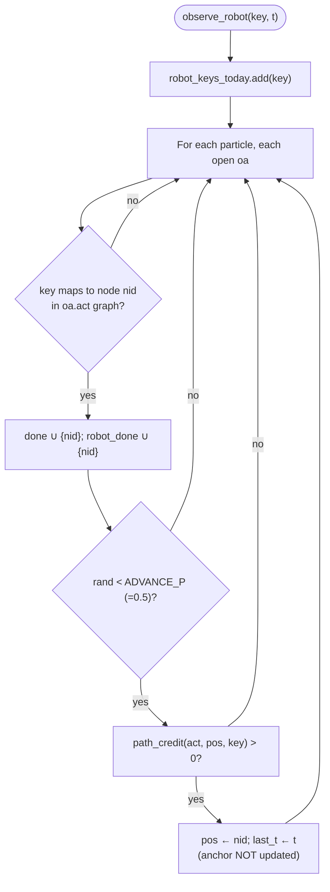

- **No weight change**, no resampling.
- **Never** opens new activities or closes existing ones.

---

## 7. `observe_reaction(obj_idx, robot_dest_idx)` — human undo

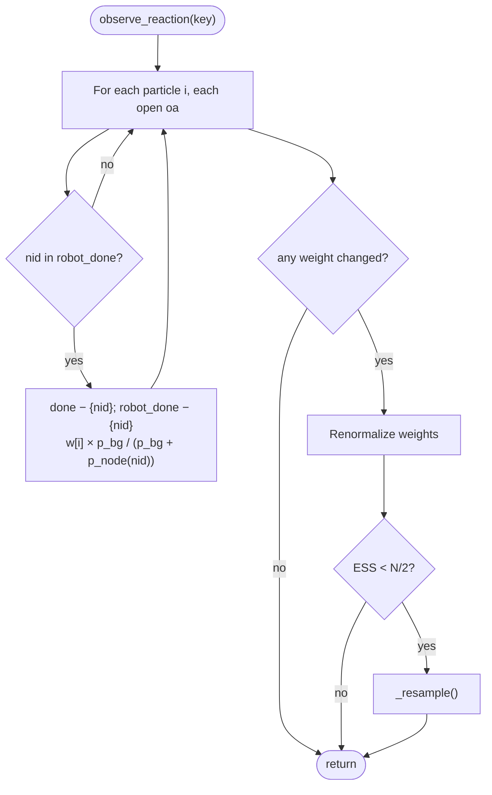

- **No** new opens, **no** closes.

---

## 8. `_resample()` — systematic resampling

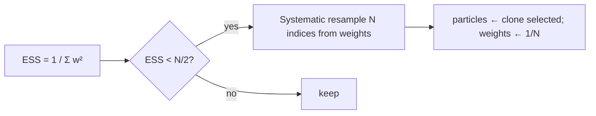

Called after `observe` and `observe_reaction` when ESS is low.

---

## 9. Day reset

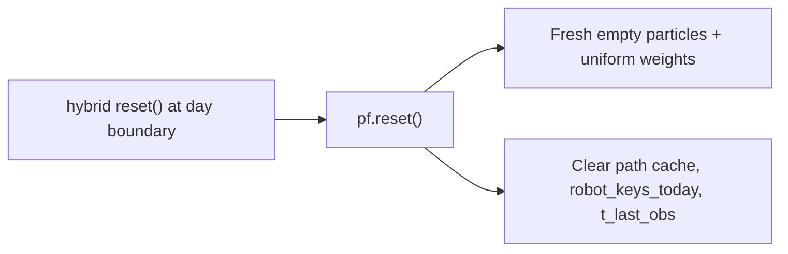

Still-open hypotheses are **discarded** (not appended to `history`).

---

## 10. Readouts (downstream, no state change)

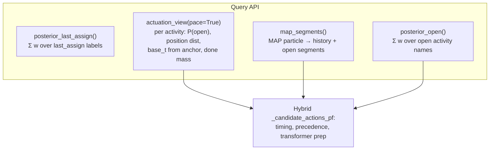

---

## 11. Hybrid integration (when each PF method runs)

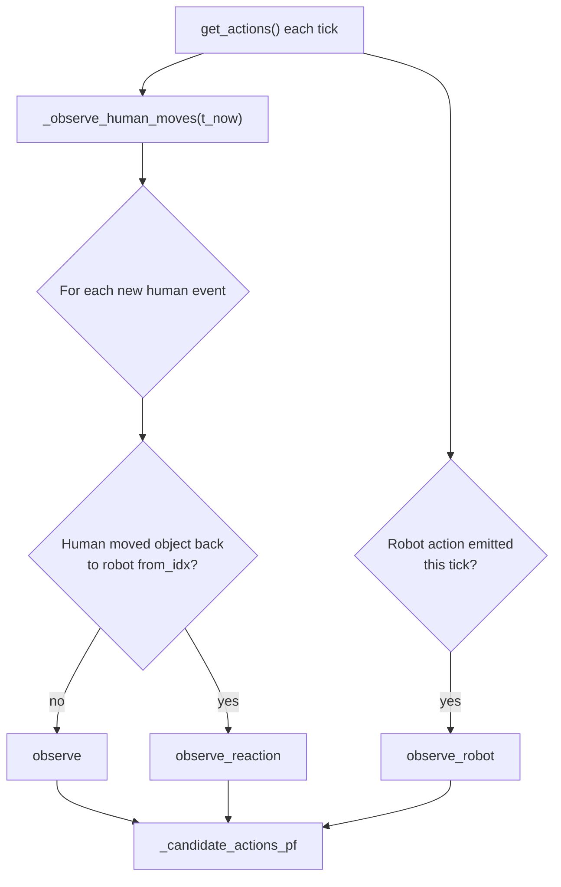

Multiple human events at the **same** `t_now`: first gets full `dt`; subsequent
calls in the same loop get `dt = 0` (no idle decay between them).

---

## 12. Constants (structural, not derived)

| Symbol | Value | Role |
|--------|-------|------|
| `N_PARTICLES` | 1000 | Ensemble size |
| `MAX_OPEN` | 3 | Concurrent open activities per particle |
| `CONT_HOPS` | 4 | Max path length in `_path_credit` |
| `ROOM_MISS_DISCOUNT` | 0.1 | Same-room wrong-destination factor |
| `STD_FLOOR_MIN` | 20 min | Clock prior σ floor |
| `ADVANCE_P` | 0.5 | Robot marker advance probability |

---

## 13. Open-activity state machine (per particle)

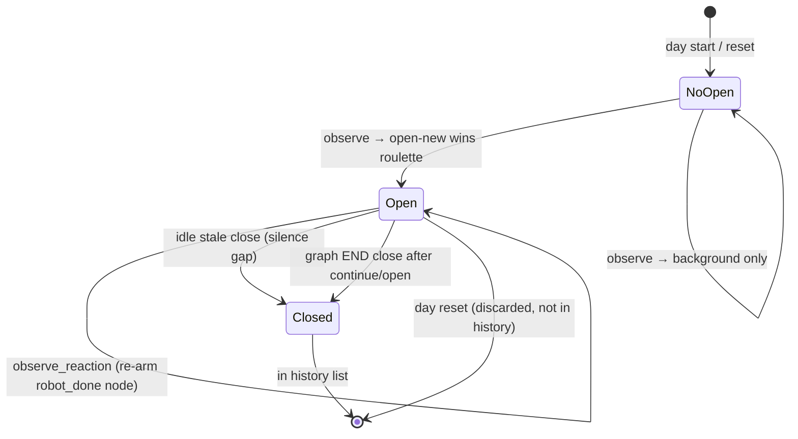
